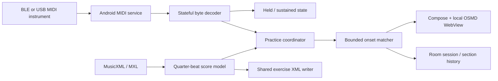

# Architecture

## Modules and data flow

`core` is a plain Kotlin/JVM library with no Android dependency. It defines musical events, secure MusicXML/MXL import, the MIDI stream decoder and keyboard state, score matching and scoring, scale generation and seeded sight reading. JUnit tests run without a phone.

`app` owns Android lifecycle, Bluetooth MIDI, Room and Compose. `PianoViewModel` is the single practice-session coordinator. `StateFlow` exposes immutable snapshots to lifecycle-aware UI collectors. MIDI byte decoding runs on the MIDI callback thread; parsed events are posted in order to the main looper, where the engine and UI state are mutated. Generations discard callbacks from a closed connection. No bounded/dropping event flow sits in the scoring path. Diagnostics retain only 120 messages.

All durations use quarter-note units regardless of time-signature denominator. Nanosecond event timestamps use Android's monotonic `System.nanoTime` time base. Wall-clock milliseconds are used only for history dates. Physical keys and sounding keys are separate channel/pitch collections. CC64 >=64 engages sustain; release clears only unheld notes on that channel. CC120/123 panic clears notes. Zero-velocity note-on becomes note-off.

## Import and notation

The importer reads one piano part; `backup`/`forward` adjust the measure cursor, `chord` reuses the previous onset, and tie chains merge by pitch/staff/voice. The first incomplete measure can be a pickup. Ordinal measure indices are used in passage selection, so an edition's displayed measure label can differ. Clefs and engraving metadata stay in the original XML for OSMD; assessment uses MIDI pitches/staff/voice/duration. Grace notes are displayed but excluded from assessment.

MXL entries are never written to disk. Expanded bytes/entry count and paths are bounded; `META-INF/container.xml` selects the score. External entity declarations are rejected and external resources resolve to an empty source. DOM feature support differs across Android/JVM, so feature flags are applied opportunistically while the entity resolver and declaration rejection remain mandatory. This is covered by Android parser smoke tests as well as JVM tests.

The WebView loads only `android_asset/notation`. OSMD and its fonts are in the vendored bundle. JavaScript receives XML through a narrow annotated bridge; navigation and file/content access are disabled and the APK has no Internet permission. UI updates pass numeric beat/pitch arrays to JavaScript. Graphical notes are indexed using OSMD's iterator and coloured without a complete render; zoom/layout changes rebuild the index. Cursor follows quarter beats. Unselected noteheads are dimmed. Loop controls provide numeric measure/beat selection and draggable engraving boundaries.

## Assessment

1. Filter onset positions by passage and staff. Group equal quarter-beat onsets; retain individual pitches, voices, durations and IDs.
2. In Rhythm mode, score against a fixed BPM clock beginning after count-in. In Follow mode, the first valid pitch anchors the clock; subsequent complete onset groups apply a bounded phase correction. Wait mode ignores timing and waits for pitch completion.
3. Match one input onset to one unconsumed expected note. Search only the current/next group, with timing windows in Rhythm mode. Follow prefers the current onset for repeated pitches. Arpeggiated chords do not require identical timestamps.
4. Rhythm and anchored Follow expire unmatched notes after a tolerance/spread guard. Follow applies bounded phase correction after complete groups; explicit Pause freezes time, and Wait is used for untimed pitch completion. Follow, played overlays and metronome share one clock. Completion at the selected end allows at most 120 ms for held-key releases; post-end attacks and metronome clicks are suppressed.
5. Physical note-off pairs FIFO by channel/pitch with matched note-ons. Compare duration to the tied expected duration, clipped at the selected passage end. Unreleased notes are penalized on finish. Sustain affects sounding state independently.
6. Pitch = matched / (expected + extra). Missing notes remain in the denominator. Rhythm gives 70% onset and 30% release credit, using tolerance-based bounded penalties and the expected-note denominator. Overall = 60% pitch + 40% rhythm. Wait mode reports pitch only. Per-hand completion excludes extras because a wrong input pitch has no reliable hand attribution. Onset standard deviation is labelled onset variation, not a direct BPM-variance measurement.

These are explainable heuristics, not a proven general-purpose score-following system. Arbitrary skips, repeats, polyrhythmic rubato and ambiguous duplicate unisons need a more advanced alignment model and a larger ground-truth performance corpus.

## Practice lifecycle

The coordinator creates a new engine for every repetition, clears held/sustained display state, resets match/duration/timing accumulators and schedules a fresh count-in. It records a Room session per completed loop. Disconnect stops assessment and clears state; it does not resume automatically into an uncertain score position. Settings/imports/history persist locally. A simulated input flag follows the entire session and is saved in history.

Room tables: `ImportEntity` (metadata and private XML filename keyed by SHA-256), `SectionEntity` (score key, beat bounds and BPM), `SessionEntity` (category, mode, summary, date and simulation flag). Note-level details live in the current session result; history stores aggregates, limited to the most recent 300 displayed sessions. No schema migration is needed for schema version 1.

Imported XML is stored in app-private files, with small Room metadata rows. This avoids Android CursorWindow limits for larger MusicXML documents.

## Offline sound and falling notes (0.2)

`PlaybackPlan` derives note-on/off events from the selected score range, clips releases at its end, orders releases before retriggers, and reserves MIDI channels 1–15 for demonstration playback. Touch notes use channel 0. `PianoViewModel.listen` schedules that plan on a monotonic timeline, updates a separate playback playhead/held-key set, and never calls the assessment engine or stores a practice session. Practice and Listen are mutually exclusive; touch playing can accompany an unscored demonstration. A playback generation prevents cancellation of an old coroutine from releasing notes in a newly started demonstration.

`SampledPiano` renders an offline 30-sample acoustic piano bank with linear resampling, velocity gain, per-channel sustain, FIFO repeated-note release, a 128-voice bound and release envelopes. The original additive synth remains a tested core utility but is not used for app sound. `PianoAudio` streams float PCM with audio focus/background cleanup. Samples and their licence/provenance are bundled; there is no runtime download.

## Recorded performance and visual review

`PerformanceEngine` retains physical `PlayedNote` on/off events, including extras, velocities, channels and expected-note associations. Recorded duration is independent of sustain and follower phase corrections. Each loop creates a new engine. `Notation` passes these events into the local OSMD SVG view: score timing is mapped to engraved onset anchors, performed heads and key-hold traces are overlaid, and a continuous cursor interpolates between note positions. It is a diagnostic overlay rather than an engraving/export engine. MIDI-only extra pitches receive approximate sharp spellings and an inferred staff; physical hand is not measured.

`TakeArchive` stores the score, settings, detailed evaluation and actual events together in private JSON files. Room v2 adds the optional review filename through an explicit v1 migration; old history remains readable. History can reopen these takes without requiring the original import file.

USB uses the same parser/evaluator as BLE, via `MidiManager.openDevice` and instrument-output ports. Device callbacks refresh the USB list, clear held notes and stop practice on disconnect. A single matching USB device can reconnect; identical devices require explicit reselection. BLE permissions do not gate USB.
